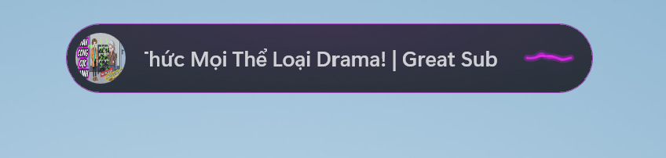
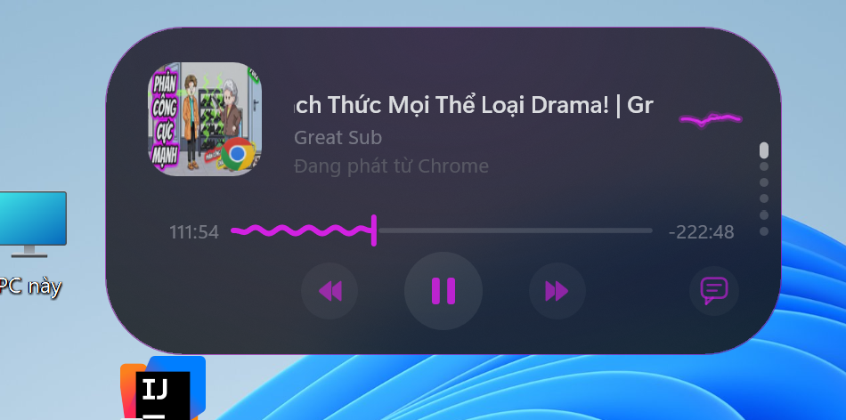
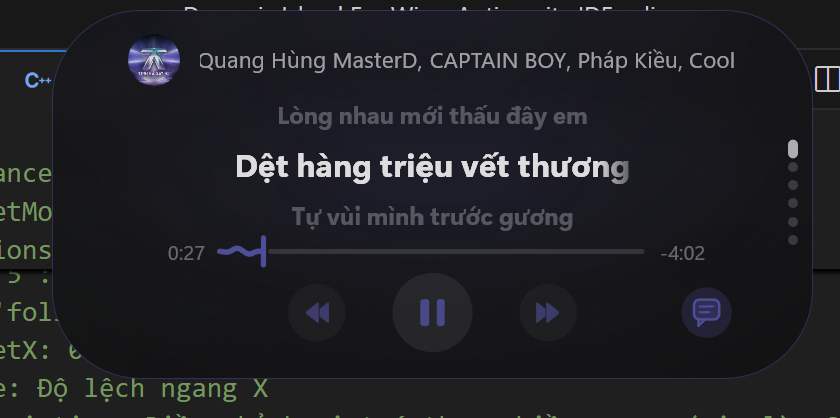
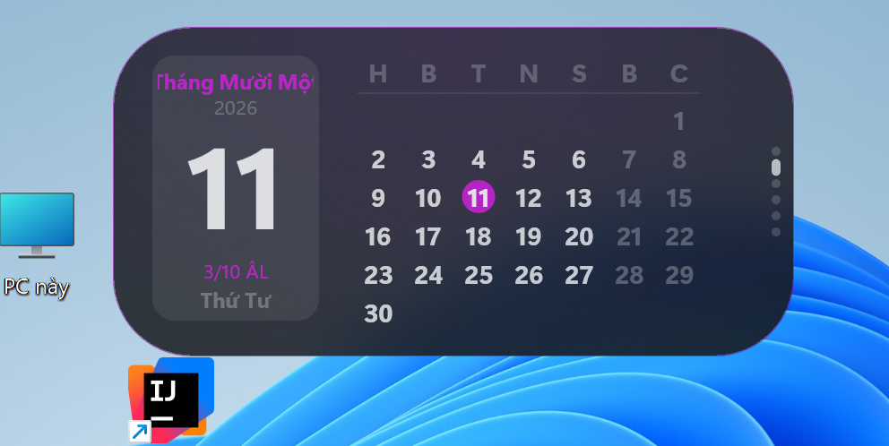
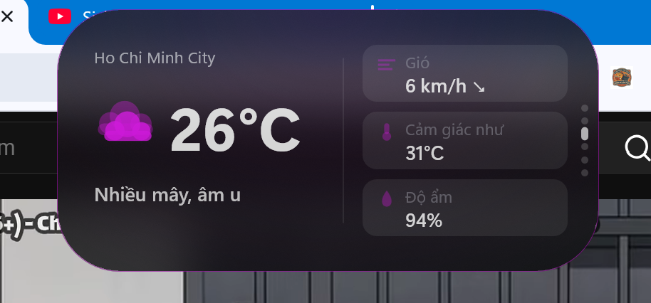
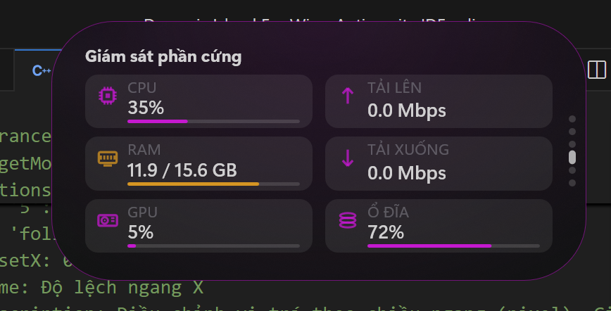
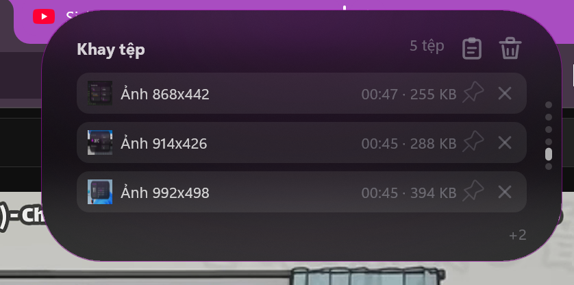

# Dynamic Island for Windows (Private Edition)

Phiên bản Dynamic Island dành riêng cho Windows được cá nhân hóa và tối ưu hóa toàn diện, mang lại giao diện viên thuốc sống động, thanh lịch với hiệu ứng chuyển động vật lý đàn hồi mượt mà (**Apple Fluid Springs**), khả năng tương tác trực tiếp trên từng tab mở rộng và tối ưu tiết kiệm tài nguyên hệ thống.

---

## 📸 Hình Ảnh Minh Họa

<p align="center">
  
  <br />
  <sub><i>Thanh thu nhỏ hiển thị ảnh bìa, tên bài tự cuộn marquee và sóng nhạc theo màu chủ đạo</i></sub>
</p>

| Trình phát Media Mở Rộng | Lời Bài Hát Karaoke Tức Thì |
| :---: | :---: |
|  |  |
| **Lịch Dương & Âm Lịch Việt Nam** | **Thời Tiết Trực Quan** |
|  |  |
| **Giám Sát Phần Cứng** | **Khay Tệp & Bộ Nhớ Tạm** |
|  |  |

---

## 🚀 Các Tính Năng & Mô-đun Nổi Bật

### 🎵 Trình phát Media & Lời bài hát siêu mượt
- **Đồng bộ thời gian thực & Karaoke:** Hỗ trợ tốc độ phát linh hoạt (`x1.0`, `x1.25`, `x1.5`, `x2.0`,...), quét sáng từng từ kiểu Karaoke và tự động giữ trạng thái mở rộng khi chuyển bài.
- **Tìm kiếm lời đa nguồn thông minh:** Tự động ưu tiên tìm lời theo thứ tự **Zing MP3 → LRCLIB → NetEase**, tối ưu nhận diện và chấm điểm khớp cả với các phiên bản **Remix, Remake, Lofi, Cover**.
- **Hiển thị mượt mà không giật dòng:** Cache sẵn `IDWriteTextLayout` theo bài hát, sử dụng phóng/thu Direct2D quanh tâm dòng kết hợp chuyển động **Spring vật lý** và làm mờ mềm hai mép trên/dưới.
- **Tương tác trực tiếp trên Tab Lời bài hát:**
  - **Kéo thả chuột dọc** trong vùng lời để xem trước/sau toàn bộ bài (hỗ trợ cả lời đồng bộ và lời tĩnh Plain lyrics).
  - **Click-to-Seek:** Hover sáng dòng + xem trước mốc `[mm:ss]`, bấm thẳng vào câu hát để tua nhạc tới đúng đoạn đó.
  - **Nút pill `Về đoạn đang hát`:** Tự xuất hiện khi cuộn xem tay để quay lại nhịp nhạc chỉ với một lần bấm.
  - **Chỉnh sync tức thì trên header:** Bấm `-` / `+` (±150ms) hoặc `↻` Resync ngay cạnh nhãn nguồn lời; cấu hình bù lệch tự tách riêng cho **Loa ngoài** và **Bluetooth**.

### 🧩 Hệ thống Tab Mở Rộng Tương Tác Toàn Diện
- **Thanh chấm phân trang (Pagination Dots):** Bấm trực tiếp vào bất kỳ chấm tròn nào ở mép Island để nhảy nhanh đến tab mong muốn, bên cạnh thao tác cuộn chuột và vuốt trượt vòng tròn vô tận theo cả 4 hướng.
- **📅 Lịch Dương & Âm lịch Việt Nam:**
  - Bấm vào bất kỳ ngày nào trên lưới lịch để xem nhanh **Dương lịch, Âm lịch, Can Chi & ngày đặc biệt (Mùng 1 / Rằm)** trên thẻ Hero.
  - Thêm nút `<` `>` chuyển tháng nhanh và bấm vào thân thẻ Hero để quay về **Hôm nay**.
- **⏱️ Đồng hồ & Focus Timer:**
  - Bấm trực tiếp vào khối đồng hồ để bật/tắt nhanh **Hiển thị giây**.
  - Tích hợp dải nút khởi động nhanh **Focus Timer (`25p` / `Nghỉ 5p` / `15p`)** và cho phép bấm trực tiếp lên pill Timer để **Tạm dừng / Tiếp tục** hoặc **Dừng (`✕`)**.
- **🌤️ Thời tiết (Open-Meteo / wttr.in):**
  - Bấm vào nhiệt độ để đổi nhanh **`°C ↔ °F`** (quy đổi tức thì và lưu đồng bộ).
  - Bấm vào tên thành phố hoặc biểu tượng thời tiết để làm mới dữ liệu ngay lập tức.
  - Bấm vào cụm thẻ bên phải để lật trang xem thêm **Áp suất không khí, Độ mây & Giờ cập nhật**.
- **📊 Giám sát Phần cứng & Game Overlay:**
  - Hiển thị **CPU, RAM, GPU, Net Up, Net Down, Disk**; các bộ đếm nặng (GPU/Mạng) chỉ chạy khi bạn đang mở tab Phần cứng.
  - Lưu lịch sử **30 mẫu** để bật/tắt **biểu đồ Sparkline** trực quan ngay bên trong từng thẻ `CPU` / `RAM` / `GPU` / `NET` khi bấm chuột.
  - Bấm thẻ **`DISK`** để mở `This PC`, hoặc dùng hai nút nhanh trên header để mở **`Task Manager`** và bật/tắt ghim **`Game Overlay`**.

### ✨ Hiệu ứng, Khay Tệp & Tối ưu Tài nguyên
- **Apple Fluid Springs & Chất liệu kính:** Hỗ trợ tới 360Hz, 8 bảng màu tùy biến, màu điểm nhấn tự trích xuất theo ảnh bìa nhạc, và nền **Windows Blur / Acrylic** thật.
- **Khay lưu tệp & Bộ nhớ tạm (File Tray):** Tự động bắt văn bản, ảnh chụp màn hình và tệp tin khi nhấn `Ctrl + C`; hỗ trợ kéo thả trực tiếp vào/ra Island và ghim giữ lại.
- **Pill trạng thái siêu gọn & Quyền riêng tư:** Âm lượng, Độ sáng, Pin, Caps/Num Lock, Bluetooth và chấm báo **Mic (cam) / Camera (xanh lá)**.
- **Tiết kiệm tài nguyên:** Tự động ngắt vòng lặp render về **0% CPU** khi khóa màn hình (Lock Screen) hoặc đang chạy ứng dụng toàn màn hình.

---

## ⚙️ Thao Tác Nhanh & Cử Chỉ

| Thao tác | Trên thanh thu nhỏ | Trong giao diện mở rộng |
| :--- | :--- | :--- |
| **Rê chuột / Nhấp chuột** | Mở rộng Dynamic Island | Tương tác trực tiếp trên nút, thẻ, câu hát, ngày lịch |
| **Nhấp đúp chuột trái** | Phát/Tạm dừng, Tắt tiếng hoặc Ghim mở rộng | — |
| **Nhấp chuột giữa (Con lăn)** | Tắt tiếng, Phát/Tạm dừng, Chụp màn hình hoặc Đóng pill | — |
| **Cuộn con lăn chuột** | Chỉnh nhanh Âm lượng hoặc Độ sáng *(tùy chọn)* | **Luôn chuyển tab** mượt mà qua lại |
| **Kéo thả chuột dọc** | Chỉnh Âm lượng / Độ sáng theo hướng vuốt | Cuộn đọc **Lời bài hát** (trong vùng lời) hoặc chuyển tab |
| **Chuột phải** | Mở menu tùy chỉnh nhanh Chủ đề, Độ trong suốt, Nguồn Media, Focus Timer, Bù lệch Lời | Mở menu tùy chỉnh nhanh |
| **Phím tắt ẩn/hiện** | Mặc định `Ctrl + Alt + D` *(tùy biến trong Settings)* | Mặc định `Ctrl + Alt + D` |

---

## 🛠️ Cấu Trúc Tệp & Biên Dịch Kiểm Tra

- `di.cpp` — Mã nguồn chính của Windhawk mod (`@id new-mod-2`).
- `lunar_calendar.h` — Tính toán chuyển đổi Âm/Dương lịch và Can Chi Việt Nam.
- `lyrics_providers.h` — Hằng số hỗ trợ truy vấn đa nguồn lời bài hát.
- `system_monitor.h` — Thu thập thông số hiệu năng CPU, RAM, GPU, mạng, ổ đĩa.

### Cách sử dụng trên Windhawk
1. Mở **Windhawk** → **Explore / Create a new mod**.
2. Dán toàn bộ nội dung [`di.cpp`](di.cpp) vào trình soạn thảo mod *(tệp đơn khối đã gộp sẵn các module hỗ trợ bên trong)* và nhấn **Compile mod**.
3. Để kiểm tra biên dịch tĩnh cục bộ qua trình biên dịch đi kèm Windhawk:
   ```powershell
   & "C:\Program Files\Windhawk\Compiler\bin\clang++.exe" -std=c++20 -O2 -Wall -Wno-unused-function -DWH_MOD -DUNICODE -D_UNICODE '-DWH_MOD_ID=L"new-mod-2"' '-DWH_MOD_VERSION=L"1.5.4"' -include "C:\Program Files\Windhawk\Compiler\include\windhawk_api.h" -c "di.cpp" -o "di.o"
   ```

---

## 📝 Nhật Ký Thay Đổi (Changelog)

### v1.5.4 — Tối ưu & Đồng bộ giao diện Menu Chuột Phải
- **Giao diện Dark/Light đồng bộ bảng màu Island (`ScopedStyledMenu`):** Loại bỏ hoàn toàn hộp thoại trắng Win32 mặc định bằng owner-drawn menu (`MFT_OWNERDRAW`) kết hợp kích hoạt Dark/Light mode hệ thống (`uxtheme` & `SetMenuInfo`) tiệp với theme đang dùng (*Obsidian, Nord, Porcelain...*) và ánh sáng hover pill bo tròn khử răng cưa theo màu accent hiện tại.
- **Tái cấu trúc gọn gàng 4 nhóm (18 dòng → 13 dòng):**
  - **Nhóm Điều khiển nhanh:** `Ghim mở rộng`, `Mở rộng khi rê chuột`, `Bảng Game (Overlay)` với dấu `✓` rõ trạng thái (thay cho nhãn đảo ngược khó hiểu trước đây).
  - **Nhóm Tiện ích & Mô-đun:** Gom toàn bộ 5 mục Lời bài hát vào 1 submenu **`Lời bài hát >`** (kèm độ lệch sync, `Đồng bộ lại hệ thống`, và badge dung lượng cache); bổ sung badge trạng thái cạnh **`Nguồn phát nhạc >`**, **`Hẹn giờ tập trung >`**, **`Khay tệp >`**.
  - **Nhóm Giao diện:** `Kiểu dáng Island >`, `Độ trong suốt >`, và `Chủ đề giao diện >` có **chấm swatch màu thật** cho từng bảng màu kèm nhãn đang chọn.
  - **Nhóm Hệ thống:** Làm rõ nghĩa nút **`Thu gọn & Đóng thẻ`**, thêm badge phím tắt bên cạnh **`Ẩn Island`** (`Ctrl+Alt+D`) và **`Mở cài đặt Windhawk`**.
- **Áp dụng đồng bộ cho popup `+N` nguồn nhạc** trên Source Dock của tab Media.

### v1.5.3 — Tương tác Tab Thời tiết & Giám sát Phần cứng
- **Tab Thời tiết tương tác:**
  - Bấm trực tiếp nhiệt độ để đổi nhanh **`°C ↔ °F`** (quy đổi tức thì trên giao diện và lưu đồng bộ vào thiết lập).
  - Bấm tên thành phố hoặc icon thời tiết để kích hoạt làm mới dữ liệu ngay qua sự kiện riêng (`g_weatherRefreshEvent`).
  - Bấm cụm thẻ chỉ số bên phải để lật trang `1/2 ↔ 2/2` xem **Áp suất (`pressure_msl`)**, **Độ mây (`cloud_cover`)** và **giờ cập nhật**.
- **Tab Giám sát Phần cứng tương tác:**
  - Thêm bộ đệm vòng **30 mẫu (`HwHistoryRing`)** cho `CPU`, `RAM`, `GPU`, `Net Up`, `Net Down`.
  - Bấm vào từng thẻ `CPU` / `RAM` / `GPU` / `NET UP` / `NET DOWN` để bật/tắt **biểu đồ Sparkline nội tuyến** kèm giá trị trực tiếp; bấm thẻ **`DISK`** để mở `This PC`.
  - Bổ sung hai nút nhanh trên header: **`Overlay`** (ghim/bỏ ghim Game Overlay) và **`Task Mgr`** (mở `taskmgr.exe`).

### v1.5.2 — Tương tác Tab Lịch & Tab Đồng hồ (Focus Timer)
- **Tab Lịch tương tác:**
  - Bấm vào ngày bất kỳ trên lưới để chọn và xem **Dương lịch, Âm lịch, ngày Mùng 1 / Rằm & Can Chi** trên cột Hero bên trái.
  - Thêm nút `<` `>` chuyển đổi qua lại giữa các tháng; bấm vào thân thẻ Hero khi đang xem ngày/tháng khác để quay ngay về **Hôm nay**.
- **Tab Đồng hồ & Focus Timer:**
  - Bấm vào khối đồng hồ để bật/tắt nhanh **Hiển thị giây** (lưu bền vững qua restarts).
  - Bổ sung dải nút **Focus Timer (`25p` / `Nghỉ 5p` / `15p`)** ở mép dưới khi không có cảnh báo Mic/Camera, hỗ trợ bấm trực tiếp pill Timer để **Tạm dừng / Tiếp tục** hoặc **Dừng (`✕`)**.

### v1.5.1 — Mượt hóa & Tương tác Tab Lời bài hát + Thanh chấm phân trang
- **Khắc phục triệt để giật/khựng chữ trên Tab Lời bài hát:**
  - Cache `IDWriteTextLayout` và `DWRITE_LINE_METRICS` theo bài hát trên cùng độ rộng wrap cố định, dùng `Matrix3x2F::Scale` quanh tâm dòng kết hợp **Spring scroll** vật lý và làm mờ mềm hai mép trên/dưới.
  - Hỗ trợ hiển thị và cuộn cho cả lời không đồng bộ (**Plain lyrics**).
- **Tương tác Tab Lời bài hát & Chấm phân trang:**
  - Giữ **cuộn chuột luôn đổi tab**, đồng thời hỗ trợ **kéo thả chuột dọc** bên trong vùng lời để xem trước/sau câu hát.
  - **Click-to-Seek:** Hover làm nổi bật câu hát kèm mốc `[mm:ss]`, bấm để tua nhạc thẳng đến câu đó; thêm nút **`Về đoạn đang hát`** và bộ nút chỉnh sync nhanh (`-` / `+` / `↻`) trên header.
  - Cho phép bấm trực tiếp từng chấm trên **thanh phân trang** để nhảy tab và chặn click xuyên gây mở nhầm ứng dụng Media ở các tab khác.
- **Tối ưu tìm kiếm & đồng bộ Media:**
  - Nâng cấp bộ tìm kiếm lời trên **Zing MP3** (fallback `/api/v2/search`, nhận diện biến thể Remix/Lofi/Cover), tinh chỉnh grace period 150ms khi click-to-expand để tránh giật khi nhấp đúp, và khắc phục lỗi kẹt mốc `0:00` khi đổi ứng dụng phát nhạc.

### v1.5.0 — Nền tảng Private Edition
- Giao diện viên thuốc sử dụng **Apple Fluid Springs**, bảng màu tùy biến kèm Blur/Acrylic, đa nguồn lời bài hát (Zing MP3 / LRCLIB / NetEase), Khay tệp kéo thả & tự động bắt Clipboard, Lịch âm dương, Thời tiết, Giám sát phần cứng theo nhu cầu và tối ưu 0% CPU khi màn hình khóa / toàn màn hình.

